# NodeDR POS: installation and step-by-step tutorial

NodeDR POS is a free, open-source point-of-sale and inventory app for shops.
This guide walks through installation, first-time setup, adding products,
making a sale, and the other tools available in the app. Every screenshot in
[`docs/screenshots/`](docs/screenshots/) is included below.

## 1. Install NodeDR POS

Choose the option that matches your device:

- **Windows 10/11 desktop app:** install [NodeDR POS from the Microsoft
  Store](https://apps.microsoft.com/store/detail/9N4D0GW2XZ37?cid=DevShareMCLPCS).
- **CasaOS / ZimaOS:** install the [NodeDR POS CasaOS
  app](casaos/README.md) from the app listing or follow its guide.
- **Windows with WSL2, macOS, or Linux:** open PowerShell on Windows, or
  Terminal on macOS/Linux, and paste the matching one-line installer:

  **Windows PowerShell**

  ```powershell
  irm https://raw.githubusercontent.com/Raktim94/nodedr-pos/master/scripts/quickstart.ps1 | iex
  ```

  **macOS / Linux Terminal**

  ```sh
  curl -fsSL https://raw.githubusercontent.com/Raktim94/nodedr-pos/master/scripts/quickstart.sh | bash
  ```

  Follow the installer prompts. It sets up Docker when needed, downloads and
  starts NodeDR POS, then prints the address to open. On the computer running
  the app, open <http://localhost:1994>. On another device on the same Wi-Fi,
  open `http://<computer-ip>:1994`.

  The installer runs a script from this project's GitHub repository. If you
  prefer to inspect it first, review
  [`scripts/quickstart.sh`](scripts/quickstart.sh) or
  [`scripts/quickstart.ps1`](scripts/quickstart.ps1) before running it.

For a manual Docker Compose setup, see the [installation
guide](README.md#installation). For a public server, put HTTPS in front of the
app before exposing it to the internet; see [where to run
it](README.md#where-to-run-it).

## 2. Create your shop

1. Open the app in a browser. On the first launch, the setup screen asks you
   to create the administrator account. Enter your own name, email, and a
   strong password.
2. Enter the shop name and address. Set the country, currency, and tax options
   that match your business. These details are used on receipts and invoices.
3. Finish setup. NodeDR POS opens the dashboard; you can change company and
   tax settings later in **Settings**.

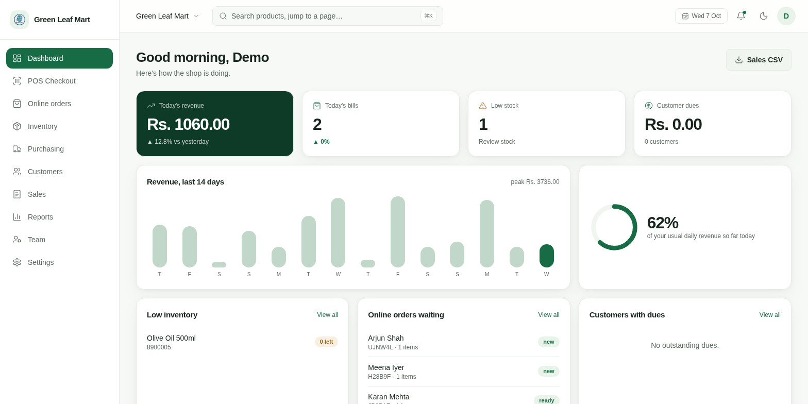

## 3. Add a product

1. Open **Inventory** and choose **Add product**.
2. Enter the product name. Add a SKU or scan an existing barcode; if the item
   has no barcode, use **Generate** to create one.
3. Enter the cost price, selling price, opening stock, and reorder level. Set
   a category and tax rate where applicable.
4. Save the product. It appears in the inventory list and is available at
   checkout. Use CSV or Excel import for a larger catalogue.

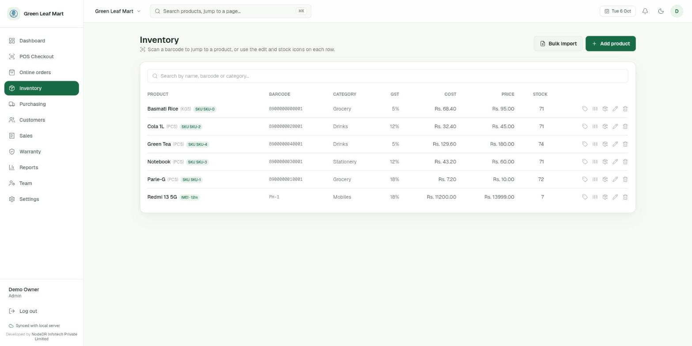

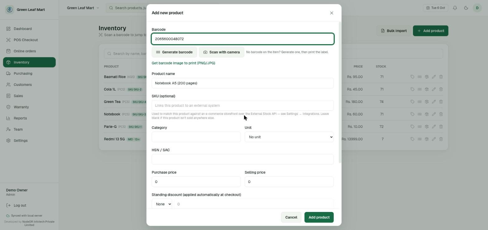

The app also has optional product features, including weighted items and
IMEI/serial tracking. Review the product options before using those workflows.

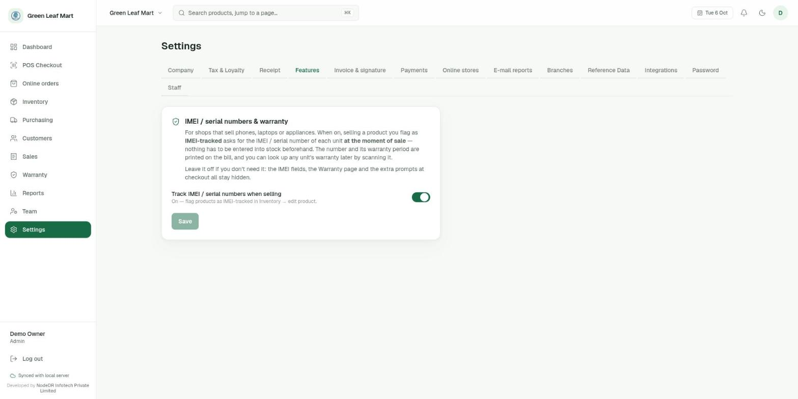

## 4. Make a sale

1. Open **POS Checkout**.
2. Scan a product barcode or search by product name, then add it to the cart.
   Scan the same item again or change its quantity to sell more than one.
3. Check the items and total. Add a customer if you want the sale linked to a
   customer record.
4. Choose the payment method shown for your shop, enter the amount received,
   and complete the sale.
5. From the confirmation, print the receipt, download a PDF, or use a
   supported receipt printer. Sales are listed under **Sales**.

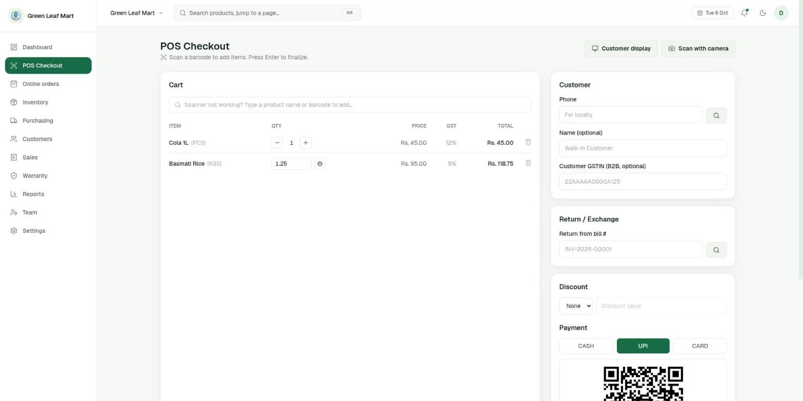

For products marked as IMEI/serial tracked, turn on tracking in
**Settings → Features**. At checkout, enter the identifier for each unit; the
identifier and warranty details can be printed on the bill and looked up later.

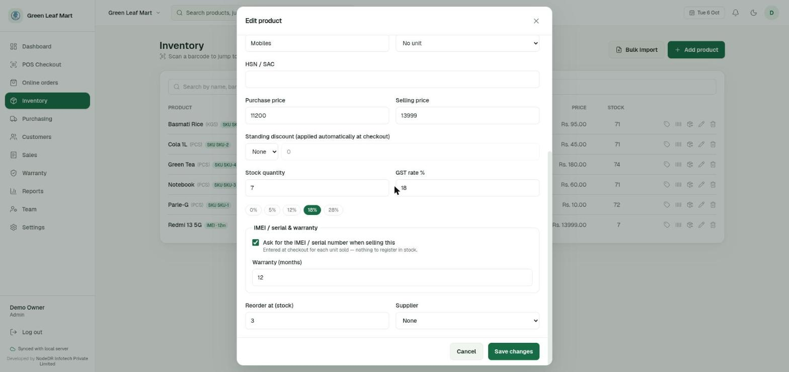

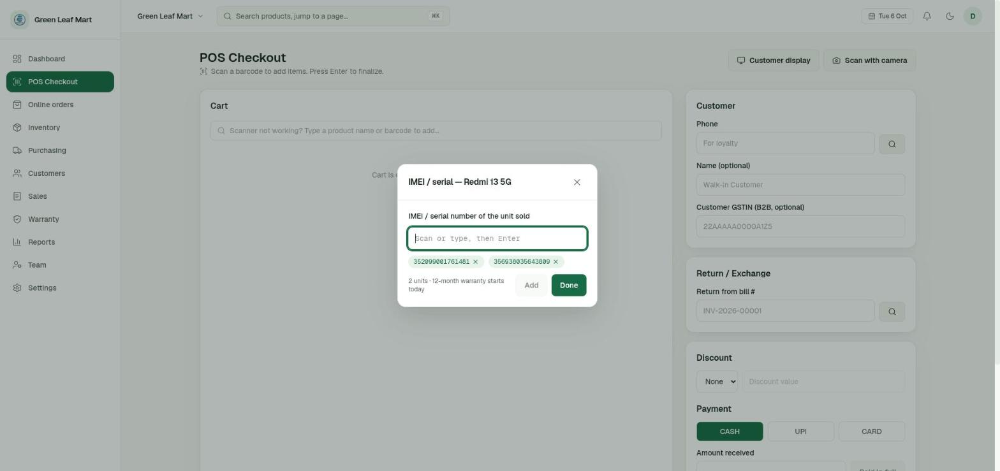

## 5. Use the other sections

### Customers

Open **Customers** to create and search customer records. A customer can be
attached to a sale, and the customer area supports sharing a loyalty page.
The list is empty until you add customers.

### Purchasing and stock replenishment

Open **Purchasing** to see products at or below their reorder point, manage
suppliers, and review purchase orders. Add a supplier first to create a
purchase order. Set reorder levels on products in **Inventory** so low stock
can appear in the reorder tab.

### Online orders

The **Online orders** board groups incoming orders as **New**, **Packing**,
**Ready**, and **Collected**. Connect a supported WooCommerce or Shopify store
in **Settings → Online stores**, or connect a custom website using the API
guide. Products are matched by SKU. Orders can represent a web-paid order or
an order paid for at pickup.

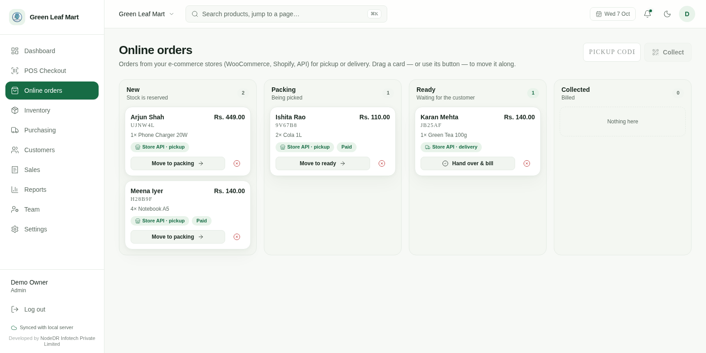

### Reports and exports

Open **Reports** and choose **7d**, **30d**, or **90d** to review revenue,
gross profit, average bill, category sales, hourly trends, and top products.
The tax filing area provides GSTR-1 CSV sections and a region-neutral tax
summary. Review exported tax figures with your accountant before filing.

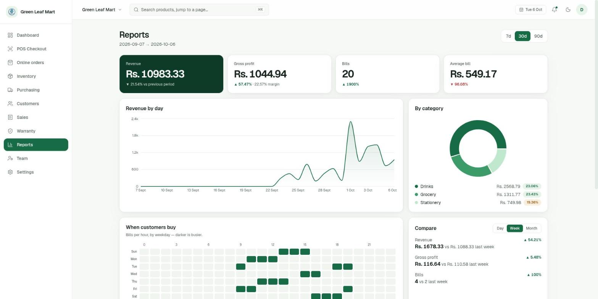

### Team access

The **Team** page shows staff accounts and their access roles. An administrator
can add a team member and assign permissions appropriate to their work.

## 6. Receipts, invoices, and warranty

Use **Settings → Receipt** to configure receipt details. Use
**Settings → Invoice & signature** for the A4 invoice layout and shop
signature. The app can print receipts or create A4 invoices with tax details.

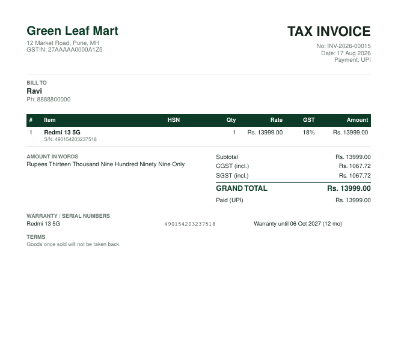

When IMEI/serial tracking is enabled, open **Warranty** and scan or enter an
identifier to find the sale and warranty status.

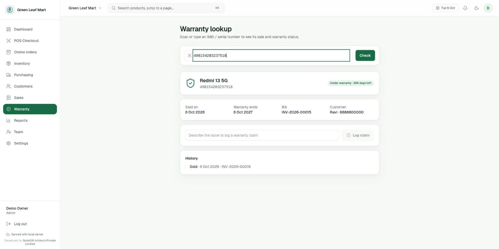

## 7. Back up and update

For Docker Compose and CasaOS installations, app data is kept in persistent
Docker storage. Back up that data regularly. To update a manual Compose
installation, run `docker compose pull` followed by `docker compose up -d`;
the in-product updater is also available when an update is published. Keep a
backup before updating.

See the [README](README.md) for more installation, deployment, and hardware
guidance.

## Screenshot gallery

These are all screenshots currently included in this tutorial:

1. Dashboard — [open image](docs/screenshots/dashboard.png)
2. Inventory — [open image](docs/screenshots/inventory.png)
3. Add product — [open image](docs/screenshots/add-product.png)
4. Product features — [open image](docs/screenshots/features.png)
5. Checkout — [open image](docs/screenshots/pos.png)
6. IMEI product setup — [open image](docs/screenshots/product-imei.png)
7. IMEI checkout — [open image](docs/screenshots/imei-sale.png)
8. Online orders — [open image](docs/screenshots/orders.png)
9. Reports — [open image](docs/screenshots/reports.png)
10. A4 invoice — [open image](docs/screenshots/invoice-a4.png)
11. Warranty lookup — [open image](docs/screenshots/warranty.png)
